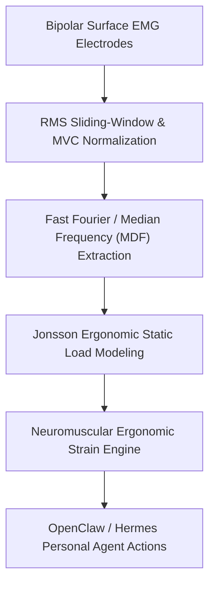

# Surface Electromyography (sEMG) RMS Workload Skill

[](LICENSE)
[](https://www.python.org/)
[](requirements.txt)
[](mcp_server.py)
[](SKILL.md)

Zero-dependency sovereign personal agent skill for non-invasive evaluation of surface electromyography (sEMG) RMS amplitude, percentage MVC, median frequency fatigue, and occupational ergonomics.



## Features
- **Deterministic Math**: Pure Python standard library implementation with zero external dependencies.
- **Biomechanical Ergonomics Standards**: Implements validated Jonsson static muscular load thresholds and %MVC normalization.
- **Spectral Fatigue Shift Detection**: Identifies localized intracellular acidification before subjective pain manifests.
- **Model Context Protocol (MCP)**: Native JSON-RPC tool integration for LLMs and autonomous agents.

## Quickstart

```python
from client import MuscleElectromyographyClient

client = MuscleElectromyographyClient()
result = client.evaluate_emg_workload(
    emg_rms_amplitude_uv=14.5,
    mvc_reference_uv=320.0,
    muscle_group="UPPER_TRAPEZIUS"
)
print("Activation:", result["mvc_percentage"], "% MVC")
print("Classification:", result["classification"])
```

## License
Apache-2.0
